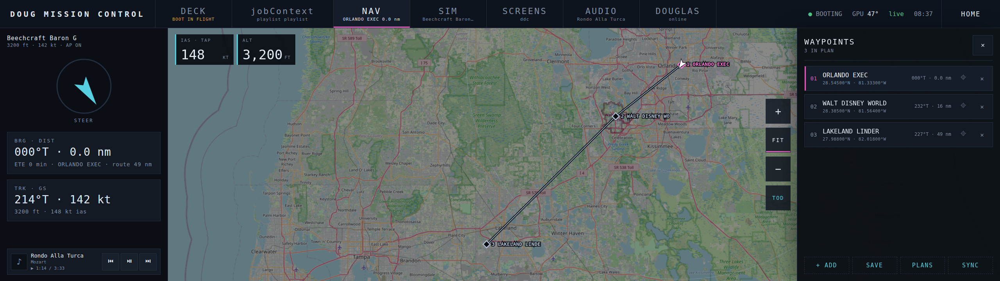
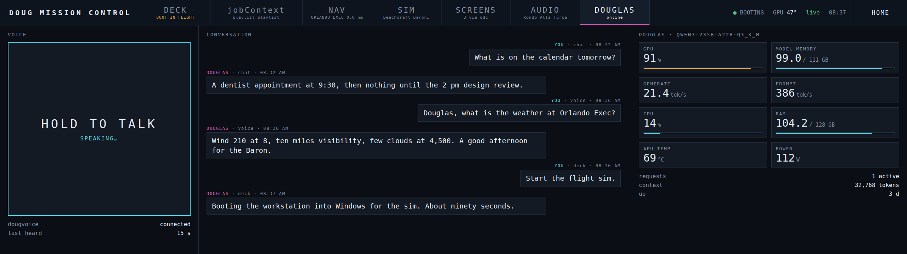
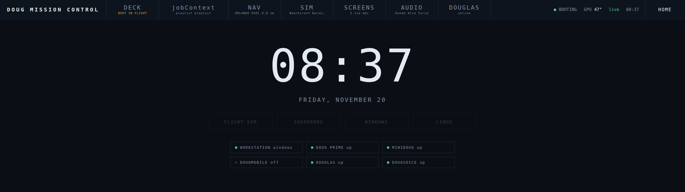

# DougMissionControl

The panel says DOUG MISSION CONTROL; so does the repo now.

Voice-controlled boot orchestration for a dual-boot workstation. Say
*"Alexa, flight sim bootup"* and the machine wakes from off, or reboots
out of Linux, lands in Windows, greets you in a neural British voice, and
launches the sim — no keyboard.

The Alexa side needs no cloud account, no skill, and no subscription: a
Raspberry Pi pretends to be a handful of Wemo smart plugs, and Alexa
routines "turn them on."

```
"Alexa, flight sim bootup"
        │
        ├─ Alexa Speaks (routine): "Right away, sir. Bringing the flight deck online."
        └─ turns on virtual device "flight sim"
                │  (fauxmo Wemo emulator on the Pi)
                ▼
        flightsim-boot.sh on the Pi probes the workstation:
                │
                ├─ Windows up   → fire greeting + launch via boot-agent /launch
                ├─ Linux up     → ssh forced-command key → firmware BootNext
                │                 → reboot
                └─ no answer    → WOL magic packet; the firmware boot order
                                  is pointed at Windows, so it lands there
                ▼
        Windows logs on → JarvisGreeting task reads the recorded intent,
        speaks the welcome, launches the matching game.
```

## The voice commands

| Phrase (yours to choose) | Virtual device | Port | Result |
|---|---|---|---|
| "flight sim bootup" | flight sim | 49915 | Windows + MSFS 2024 |
| "boot into Windows" | pc | 49917 | Windows, greeting only |
| "squadron bootup" | squadrons | 49918 | Windows + STAR WARS Squadrons |
| "workstation bootup" | workstation | 49916 | Linux + VS Code |

Each Windows device records *why* it booted (`FLIGHT_INTENT`) to
`/tmp/flightsim-intent` on the Pi. At logon, `jarvis-greeting.ps1` reads
that back over ssh and runs the matching entry in its `$LaunchProfiles`
table — so one greeting script serves every launch profile, and a
power-button boot (no intent recorded, or one older than 30 minutes)
launches nothing.

## Layout

```
pi/setup.sh              installs fauxmo + the orchestrator on the Pi, mints the ssh key
pi/flightsim-boot.sh     the orchestrator itself (→ /usr/local/bin on the Pi)
windows/setup.ps1        WOL, Fast Startup, logon task, boot agent, firewall, token
windows/jarvis-greeting.ps1   the spoken greeting + launch profiles (logon task)
windows/boot-agent.ps1        token-guarded :9107 endpoint (SYSTEM startup task)
windows/efi-entry.ps1         finds the GRUB firmware entry, so /reboot can
                         hand back to Linux without writing to ext4
windows/set-primary-display.ps1  makes one monitor primary, so a profile can
                         say which screen its game opens on (`-List` to look)
linux/setup.sh           GRUB saved-default, boot-to-windows helper, WOL, greeting, media-agent
linux/set-boot-order.sh  points the UEFI boot order at Windows, so a COLD
                         power-on lands in the sim in one boot, not two
linux/boot-agent.py      token-guarded :9108 endpoint (the mirror of the Windows one)
linux/grub_utils.sh      finds the Windows menuentry (single- or double-quoted)
linux/efi_utils.sh       finds the Windows and GRUB entries in `efibootmgr`
linux/ssh_utils.sh       installs the Pi's forced-command authorized_keys line
linux/scarlett-reset.py  USB-replug for the Focusrite after a warm dual-boot
linux/seamless-displays.sh  pins EDID + forces connectors on, so a SCREENS input
                         switch does not tear the desktop down (--revert undoes it)
linux/media-agent.py     :9110 — now-playing (MPRIS), monitor input switching
                         (DDC) and the output spectrum (parec + numpy), the
                         Linux twin of the sim-agent's /media, /monitor, /audio
                         plus /speak: Douglas's voice on this machine's speakers
douglas/douglas-agent.py :9111 on Douglas — metrics, voice state, transcript and
                         push-to-talk relay for the DOUGLAS surface (douglas/setup.sh)
douglas/provision.sh     fresh Ubuntu 24.04 → Douglas: tailnet, GTT limit, llama.cpp
                         (Vulkan) :8081, Open WebUI :8080, Wyoming STT/TTS, voice
douglas/douglas-voice.py :10800 — DougVoice's pipeline: satellite → STT → Douglas → TTS
dougvoice/setup.sh       Pi Zero 2 W + Whisplay HAT → DougVoice, Douglas's satellite
dougvoice/dougvoice.py   :10700 Wyoming satellite launcher, and the LCD/LED/button face
tests/                   shell tests for the above — `bash tests/test_*.sh`

Flight Deck — the touchscreen front-end (v0.1):
pi/display-check.sh      read-only: is the XENEON Edge's video + touch sound?
pi/setup-display.sh      cage + chromium kiosk on the Edge, mode pinning
pi/setup-deck.sh         installs deck-api, repoints fauxmo at it
pi/deck-api/deck_api.py  one entry point for every trigger; state + SSE
pi/deck-api/test_phases.py   phase mapping vs the orchestrator's real log lines
pi/deck-ui/              the panel itself — index.html, deck.css, deck.js, selftest.html
pi/deck-ui/js/           the panel as ES modules — deck.js is now just wiring:
                           format, geo, series   pure logic, unit-tested in node
                           ui                    $, rows, hold-to-arm, POST
                           track, spark, gauges  drawing, given the state to draw
                           nav, sim, screens, media   a surface each, owning its
                                                 own state and its own listeners
tools/screenshots.mjs    renders every surface at 2560x720 for the images above
                         (node + any installed Chrome + internet for map tiles;
                          `npm install playwright-core` first, `npm.cmd` on
                          Windows if PowerShell blocks the npm wrapper)

The Windows sim agent (docs/SIM-AGENT-BRIEF.md):
windows/sim-agent/       flightdeck-sim-agent — SimConnect, media, DDC, GPU
                         telemetry and the output spectrum, all on :9109
windows/setup-sim-agent.ps1   build, token, firewall, logon task
windows/scarlett-power.ps1    keep the Scarlett on the bus (power mgmt + ghosts)
```

## One-time setup (in this order)

Every address in this repo is an example — `192.168.1.50` is the
workstation, `192.168.1.51` the Pi, `192.168.100.1` a point-to-point link
to the workstation's Linux boot. Substitute your own throughout.

1. **Windows boot** (elevated PowerShell):
   ```
   powershell -ExecutionPolicy Bypass -File windows\setup.ps1 `
       -PiHost user@192.168.1.51 -AdapterName Ethernet
   ```
   — arms NIC WOL, disables Fast Startup, installs the JarvisGreeting
   logon task and the boot agent, prints the agent token and a BIOS +
   auto-logon checklist. `-PiHost` is baked into the installed greeting so
   it can read back which trigger caused the boot; a re-run without it
   keeps the value already installed.
2. **Pi** (from either boot):
   ```
   PI_HOST=user@192.168.1.51 PI_LAN_IP=192.168.1.51 \
   WS_LAN=192.168.1.50 WS_MAC=AA:BB:CC:DD:EE:FF \
   WS_BROADCAST=192.168.1.255 LINUX_SSH=user@192.168.100.1 ./pi/setup.sh
   ```
   — installs fauxmo and the orchestrator, writes those values to
   `/etc/flightsim/boot.env`, prints the Pi's public key. Add the token
   from step 1 to that file as `WIN_AGENT_TOKEN=`. The env file is the
   one place to correct an address later; re-runs keep your edits.
3. **Linux boot** (sudo, with the key from step 2):
   `sudo ./linux/setup.sh 'ssh-ed25519 AAAA… flightsim-boot@pi'`
   — GRUB_DEFAULT=saved, a UEFI boot order with Windows first (see
   [Which OS a cold boot lands in](#which-os-a-cold-boot-lands-in)), the
   `boot-to-windows` helper, the forced-command
   authorized_keys entry, persistent `ethtool wol g`, the `:9108` boot
   agent, and the Linux logon greeting + VS Code autostart. It prints a
   `LINUX_AGENT_TOKEN=` line; add that to `boot.env` on the Pi too. The
   public key is optional — omit it to install everything except the ssh
   path, and the Pi will use the token-guarded agent instead.
4. **BIOS**: enable "Resume by PCI-E/PME" (Wake on LAN) and **disable**
   ErP/EuP deep-off, or the NIC loses standby power at S5 and cold-boot
   wake silently fails.
5. **Pin the workstation's IP** — DHCP reservation at the router, or a
   static address in both OSes. A machine that is powered off cannot renew
   or defend its DHCP lease, so the first genuinely cold night is when some
   other gadget takes its address — and every probe, token callback and
   agent call in this system dials a number a stranger now answers. Found
   the hard way: an Echo took `.50` overnight and the panel called a
   running workstation "off" while WOL woke it perfectly. Two subnet traps
   while you are in there: mesh routers commonly hand out a **/22**, so a
   `.255` broadcast address copied from a /24 example is just a
   nonexistent host (the WOL sender now also unicasts for this reason),
   and a hand-typed static mask of `255.255.255.0` on a /22 LAN recreates
   the same bug one layer down.
6. **Auto sign-in** (needed for a truly hands-free cold boot — the
   greeting and launches are logon-triggered): `netplwiz` → uncheck
   "Users must enter a user name and password". On Windows 11 that
   checkbox is hidden until you set
   `HKLM:\SOFTWARE\Microsoft\Windows NT\CurrentVersion\PasswordLess\Device`
   → `DevicePasswordLessBuildVersion` = 0. Sysinternals Autologon also
   works and ignores the whole dance.
7. **Alexa app**: "Alexa, discover devices" finds the virtual plugs
   (they appear under Plugs). Then More → Routines → **+** → When:
   *Voice* → your phrase → Action 1 *Alexa Says* (your Jarvis line) →
   Action 2 *Smart Home* → the device → **On**.

## Flight Deck — the touchscreen (v0.1)

A Corsair XENEON Edge (2560 × 720, HDMI + USB HID touch) on the Pi, giving
the same four triggers a physical panel — plus the thing voice cannot: a
live picture of the ninety seconds after you ask. It hangs off the Pi rather
than the workstation, because the workstation is the subject of every
control on it.

```
./pi/display-check.sh          # prove video + touch; fix every ✗ before continuing
sudo ./pi/setup-display.sh     # cage + chromium kiosk, opens the touch self-test
sudo ./pi/setup-deck.sh        # deck-api on :8088, repoints fauxmo, real UI
```

`flightsim-boot.sh` is **not modified**. `deck-api` triggers it exactly as
fauxmo always has and derives boot phases by following the script's own
`journalctl -t flightsim-boot` output, so a boot started by voice, by touch,
or by hand all show up the same way.

| | |
|---|---|
| `GET /api/state` | everything the panel renders |
| `GET /api/events` | the same, streamed over SSE |
| `POST /api/boot` | `{"intent":"sim\|squadrons\|plain\|code"}` |
| `POST /api/launch` | target already up — fire greeting + profile |
| `POST /api/abort` | kill an in-flight run |
| `POST /api/hook/greeting` | for the Windows callback; not wired in v0.1 |

Loopback needs no token; anything else needs `DECK_TOKEN` from
`/etc/flightsim/boot.env`. Phases 6–7 (LOGON, LAUNCHED) stay dark until
`jarvis-greeting.ps1` gains a callback — nothing on the Windows side is
touched, so a run completes at **OS UP**.

### The surfaces

Five surfaces behind a persistent 72 px strip, all of them live at once —
nothing is unmounted when you look away, because reloading the Grafana frame
would restart the playlist every time you glance at DECK.

These are rendered from the real `deck-ui` at true panel pixels by
`tools/screenshots.mjs`, against a scripted state frame. They are what the
panel looks like, not a mock-up, and they can be regenerated after any change.

**DECK** — the boot you just asked for, while it happens. Phase track,
rolling GPU telemetry, the fleet, and an ABORT that only appears with a boot
in flight.


**NAV** — a moving map from the sim agent's observed position. Waypoint
search hits real OpenStreetMap data, plans are saved on the Pi, and the trail
is where the aircraft has actually been. Pinch to zoom; FIT hands framing back
to the auto-fit.



**SIM** — observed aircraft state and the controls that command it. The panel
never draws the commanded state: a tap shows PENDING over the last *observed*
value, and only the simulator moving it changes what you see. That is what
makes a command MSFS ignored look like a failed command instead of a lie.

Each autopilot bug carries the mode that reads it. A bug on its own is only a
target — set AP SPD to 165 with no mode engaged and the throttle never moves —
so the tile says *FLYING THIS BUG* or *BUG ONLY · MODE OFF* rather than leaving
a number sitting there looking authoritative.


**SCREENS** — one card per monitor, named by its position on the desk, with a
button per input the panel declares. DDC/CI over whichever OS is booted:
Windows answers through the sim agent, Linux through `media-agent.py`.

Panels that won't declare their inputs — the HP 32f refuses the capabilities
request outright — fall back to `MON_DEFAULT_INPUTS`, an operator-stated fact
about this desk rather than a guess from a model table. Whatever that list
says, the input a monitor is *observed on* is always offered too: a default
written for two identical HPs mentions no DisplayPort, and without that rule
the panel could move a third monitor to HDMI with no button anywhere to bring
it back.


**AUDIO** — what is playing, and what it actually sounds like. The spectrum is
measured on the workstation by the sim agent's WASAPI loopback capture, because
the panel runs on the Pi and has no audio of its own to look at. Reachable from
the strip or by tapping the now-playing widget on DECK — the transport buttons
inside it still skip rather than navigate.

The bands are real. There is no fallback pattern and no idle animation: silence
draws flat bars, and no capture session says so in words. A visualiser driven by
track position would be the same class of lie as drawing a commanded gear
position, which this panel refuses to do anywhere else.


**DOUGLAS** — the AI, on its own box. Push-to-talk on the left, the
conversation in the middle, and on the right what Douglas is spending: GPU,
unified model memory, tok/s, CPU, RAM, temperature and power. The panel has no
microphone, so holding PUSH TO TALK asks Douglas to have DougVoice listen —
the same as DougVoice's own button — and the button's colour is the voice
pipeline's observed state, not the press. Everything comes from
`douglas-agent` via `/api/douglas`, polled only while the surface shows; with
the agent unreachable every meter reads "—" rather than an idle-looking 0.
Reachable from the strip or by tapping the DOUGLAS line under DECK's boot
tiles.



**On a phone** — `http://node1:8088/m`, over the tailnet. The same deck in one
column: the workstation with its hold-to-arm boot tiles, Douglas (status,
meters, the last few turns, a box to type to him, push-to-talk, and a link
to its own chat page), now playing, the fleet and the event log. When Douglas
has a vision model the ask box grows a camera button: take or pick a photo,
add a question or not, and he answers about what is in it. The photo is
scaled to 1280 px on the phone before it is sent. Same SSE frame, same endpoints, same
rules as the panel.

A phone's link to node1 is not a wire: on the tailnet it can drop to a relay,
or go quiet for a minute or two at a time. So every request from the page has
a time limit, and SEND is never greyed out: a question that cannot go yet
waits, and goes by itself on the first poll that shows node1 is back and
Douglas is free. The line under the ask box says what it is waiting for and
counts the time, and the button reads STOP while a question is on its way.
Each question carries an id, so a copy that arrived with only its reply lost
is not asked twice. The page has to stay open for a waiting question to go.
On node1, `journalctl -u deck-api` has one line for each question (its size
and outcome, never its words) and one for a request that did not arrive
whole; `journalctl -u tailscaled` shows whether the phone was on a direct
path or a relay at the time, and `tailscale debug peer-endpoint-changes
<device>` has the detail.

A phone is not loopback, so it needs `DECK_TOKEN`: run
`sudo ./pi/mobile-link.sh` on node1 and open the link it prints (a QR code too
when `qrencode` is installed). The page keeps the token in that browser and
strips it from the address bar; "Add to Home Screen" makes it a full-screen app.
On an iPhone that app is a browser of its own and shares nothing with Safari,
so it asks for the token once: in Safari, tap COPY THIS PHONE'S TOKEN at the
bottom of the page, then paste it into the app's token screen (which also
takes the whole link).

HOLD TO TALK on the plain page borrows DougVoice's ears, exactly as the
panel's button does: a plain-HTTP page is not allowed the phone's own
microphone. The button says so, and when a press picks up nothing the line
under the ask box says that too ("DougVoice heard nothing in 3.5 s"), from the
length, level and word count the pipeline keeps of each listen (never the
words).

**Talking through the phone.** A browser lends a page its microphone only on
HTTPS. `sudo ./pi/mobile-https.sh`, run on node1, puts the phone page on
`https://<node1>.<tailnet>.ts.net/m` with `tailscale serve`: tailnet only, as
before. It needs HTTPS enabled for the tailnet, and issuing the certificate
records the machine's tailnet name in the public certificate log. Requests
that arrive that way reach deck-api from loopback, the address the panel is
trusted on, so deck-api asks anything a proxy forwarded for the token, and the
script takes the HTTPS front down again if a request without one gets in.
The plain page then offers TALK THROUGH THIS PHONE, a link that takes the
phone's token along. On the HTTPS page HOLD TO TALK records through the
phone's own microphone (16 kHz, up to 20 s), sends the recording through the
same waiting queue as a typed question, and plays Douglas's reply through the
phone; nothing is played in the house. An iPhone that has just lent a page
its microphone treats the page's sound as a telephone call, out of the
earpiece at call volume, so the recording has an audio context of its own
that is closed when the button is let go, and the reply is played by an
ordinary media element with the page's audio session set to playback. `sudo ./pi/mobile-https.sh off` undoes
it.

**IDLE** — the resting state, and the default surface: a clock, the boot
tiles, and the fleet's status cards. The panel spends most of its life with nothing
happening, and its previous default was the densest surface it has. Nothing
here updates faster than once a second, nothing glows, and the only colour is
the green of a machine that is actually up. The strip has no IDLE button on
purpose — you do not navigate to rest, the panel returns there by itself.
`DEFAULT_SURFACE=evals` in `boot.env` restores the old behaviour.

A SHUT DOWN control lives on DECK beside ABORT — same hold-to-arm, amber
rather than red, powering the workstation off through whichever OS is up
(`/shutdown` on either boot agent). It hides during a boot, ABORT hides
outside one, so the two never appear together and each keeps the full width.



**jobContext** — the pre-existing Grafana wallboard, framed as-is. Flight Deck
provisions no dashboards, stores no eval data, and contributes only the strip,
the sub-nav built from Grafana's own dashboard list, and AUTO pinning.

*Not shown: the frame's contents are third-party software that is not part of
this repo, and a screenshot of a stand-in would document nothing real.*

### Live telemetry, and only live

GPU temperature, utilisation and VRAM come from the exporters that already
answer on `:9105` / `:9106` — this project installs none of its own. deck-api
parses what they emit and keeps **only the latest value**; the rolling
60-minute window behind the sparklines lives in the browser's memory and dies
with the page.

There is deliberately no Prometheus, Grafana, Loki, or long-term retention.
This targets the existing Pi 4B with 4 GB and a USB thumb drive, and a TSDB
on flash with no real wear levelling corrupts before it dies. deck-api state
lives in tmpfs and `/tmp` is moved there too, so nothing writes in a loop.

When neither OS answers, the trace breaks rather than reading zero — on a
dual-boot machine that gap *is* the reboot.

Both `pi/deck-api/test_phases.py` and `test_telemetry.py` run anywhere, with
no Pi and no exporter needed. See [docs/DESIGN.md](docs/DESIGN.md) for the
full picture.

## Configuration

Most values live in `/etc/flightsim/boot.env` on the Pi (created by
`pi/setup.sh`, never overwritten):

| Variable | Meaning |
|---|---|
| `WS_LAN` | workstation's LAN IP — must be the same under both OSes (DHCP reservation by MAC) |
| `WS_MAC` | that NIC's MAC, the WOL target |
| `WS_BROADCAST` | subnet broadcast address for the magic packet |
| `LINUX_SSH` | user@host for the Linux boot (a direct-link IP is fine) |
| `WIN_AGENT_TOKEN` | must match `C:\ProgramData\dualboot\boot-agent.token` |
| `LINUX_AGENT_TOKEN` | must match `/etc/flightsim/boot-agent.token` on the Linux boot. Unset means every reboot-to-Windows request goes over the ssh key instead |
| `LINUX_AGENT_PORT` | the Linux boot agent's port (default 9108) |
| `LINUX_MEDIA_TOKEN` | must match `/etc/dualboot/media-agent.token` on the Linux boot. Unset means MEDIA and SCREENS stay dark under Linux — deck-api skips the agent entirely rather than guessing |
| `LINUX_MEDIA_PORT` | the Linux media/monitor agent's port (default 9110) |
| `SIM_AGENT_TOKEN` | must match `C:\ProgramData\dualboot\sim-agent.token`. The same token guards SIM, MEDIA and SCREENS under Windows — one agent serves all three |
| `SIM_AGENT_PORT` | the Windows sim agent's port (default 9109) |
| `POLL_SECS` | how long to keep watching a boot (default 300) |
| `DOUGLAS_HOST` | Douglas's address (default `douglas`, its MagicDNS name) |
| `DOUGLAS_AGENT_TOKEN` | must match `/etc/douglas/agent.env` on Douglas. Unset means the DOUGLAS surface says so instead of drawing meters |
| `DOUGLAS_LLM_PORT` / `DOUGLAS_CHAT_PORT` / `DOUGLAS_STT_PORT` / `DOUGLAS_TTS_PORT` / `DOUGLAS_AGENT_PORT` | Douglas's service ports (defaults 8081 / 8080 / 10300 / 10200 / 9111) |
| `VOICE_HOST` / `VOICE_SAT_PORT` | DougVoice's address (default `dougvoice`) and Wyoming satellite port (default 10700) |

Hardcoded elsewhere and worth knowing about: the Pi's address in
`jarvis-greeting.ps1` (for the intent read-back), the device names and
ports in `pi/setup.sh`, and the launch commands in `$LaunchProfiles`.

### Adding a game

Three edits: a new device block in `pi/setup.sh` with
`FLIGHT_INTENT=<key>`, a matching entry in `$LaunchProfiles` in
`windows/jarvis-greeting.ps1` (command plus the Jarvis closing line), then
redeploy both sides, re-run Alexa discovery, and add a routine.

### Choosing which screen a game opens on

A launch profile can also say what the desk should look like before the game
starts. Both fields are optional, and a profile with neither leaves everything
exactly as it found it:

```powershell
sim = @{
    cmd     = { explorer.exe shell:AppsFolder\Microsoft.Limitless_8wekyb3d8bbwe!App }
    display = '3840x1080'      # make this monitor primary first
    input   = 'dp1'            # and put every monitor on this DDC input
    closing = 'The flight deck is ready when you are.'
}
```

`display` exists because both of these games take the **primary display and
nothing else** — Squadrons is Frostbite and has no monitor picker at all — so
"launch on the ultrawide" really means "make the ultrawide primary first".
Windows has no cmdlet for that; `set-primary-display.ps1` does it through
`ChangeDisplaySettingsEx`, moving the new primary to the origin and carrying
every other monitor with it so the desktop does not end up with a hole in it.
Run it with `-List` to find a string that identifies the panel you mean:

```powershell
C:\ProgramData\dualboot\set-primary-display.ps1 -List
```

Matching is deliberately strict about ambiguity — two identical 1920×1080
panels both match `1920x1080`, and it will refuse rather than pick one, because
making the wrong monitor primary rearranges the whole desktop.

`input` switches DDC through the sim agent already running on the box, the same
endpoint the SCREENS surface drives, so there is exactly one implementation of
DDC on this machine. Leave it unset unless you know which input your PC is on:
sending a monitor to an input nothing is plugged into blanks it until you find
the OSD.

Neither can stop a launch. A monitor that will not move is a worse evening than
a game on the wrong screen, and both failures are warnings that the greeting
carries on past.

## Which OS a cold boot lands in

A powered-off machine has nobody left to ask. Whatever the last running OS
wrote down is what a Wake-on-LAN packet boots into, so the only real
question is where that setting lives.

It cannot live in GRUB, because only one of the two boots can write it.
Linux runs `grub-reboot`; Windows has no ext4 writer, so it can neither do
that nor edit `grubenv`. That asymmetry used to show up as a two-boot cold
start: GRUB's saved default is Linux, so "boot Windows" from cold **booted
Linux**, waited for it to answer, and only then rebooted into Windows —
a GRUB countdown showing the wrong OS, several minutes, and a real chance
of exhausting `POLL_SECS`.

The UEFI boot variables are the one switch both sides can throw, so the
cold default lives there instead, pointed at Windows:

| From | To | How |
| --- | --- | --- |
| off | Windows | firmware `BootOrder[0]` = Windows Boot Manager |
| Linux | Windows | `efibootmgr -n <windows>` (`boot-to-windows`) |
| Windows | Linux | `bcdedit /set {fwbootmgr} bootsequence <ubuntu>` → GRUB |
| off | Linux | WOL into Windows, then the row above |

`linux/setup.sh` applies this via `linux/set-boot-order.sh`; run that alone
(`sudo ./linux/set-boot-order.sh`, or `--print` to look first) after
reinstalling either bootloader, because the entry numbers change.
GRUB's own configuration is untouched — its saved default stays Linux,
which is exactly what the Windows → Linux leg needs once the firmware has
handed over.

Two things follow from this. Powering the machine on **by hand** now goes
straight to Windows without showing the GRUB menu; use the firmware's
one-time boot menu (F8/F11/F12, board-dependent) to reach Linux that way.
And a cold boot to *Linux* is now the two-boot direction — deliberately,
since Linux is the rare target here.

Neither step is required. On a legacy-BIOS install, or a firmware whose
boot list has no Windows entry, `set-boot-order.sh` refuses and says why,
and both agents fall back to the old GRUB-default behaviour.

### Local inference lives on Douglas

The workstation no longer runs a model. Douglas — a headless GEEKOM A9 Mega
(Ryzen AI Max+ 395, 128 GB unified memory) on the tailnet — is the home of
the assistants, so the workstation's GPU belongs to the games and the old
"a game's boot keeps its VRAM" juggling is gone. Re-running `setup.ps1`
removes the `LlamaServer` logon task and its firewall rule. On the Linux
boot, disable the old unit by hand (it was never installed by this repo):

    sudo systemctl disable --now 'llama-server@*'

Douglas serves llama.cpp on `:8081` (start it with `--metrics` for the
tok/s meters), Open WebUI on `:8080`, and Wyoming speech-to-text/text-to-speech
on `:10300`/`:10200` for DougVoice, with his own voice (`douglas-tts`) on
`:10210`. `douglas/setup.sh`, run on Douglas,
installs `douglas-agent` (`:9111`) — the panel's one window into it — and
mints the token that goes into the Pi's `boot.env` as `DOUGLAS_AGENT_TOKEN`.
The Pi reaches Douglas and DougVoice by MagicDNS name (`douglas`,
`dougvoice`), so the Pi must be on the tailnet with `--accept-dns`, or
`DOUGLAS_HOST` / `VOICE_HOST` must be set to full names.

#### Provisioning Douglas

`douglas/provision.sh` takes a fresh Ubuntu Server 24.04 to all of the above
and runs `douglas/setup.sh` at the end. In order:

1. **BIOS:** set the iGPU's UMA frame buffer to its minimum (512 MB). The
   model lives in GTT, which is ordinary RAM the GPU maps; RAM carved out as
   VRAM is RAM GTT can never have.
2. **`sudo TS_AUTHKEY=tskey-… ./douglas/provision.sh`** — hostname `douglas`,
   the HWE kernel and Mesa (Strix Halo's gfx1151 needs both newer than 24.04
   GA), Tailscale, the GTT/TTM limit on the kernel command line, llama.cpp
   built for Vulkan/RADV, Open WebUI, faster-whisper, Piper, the Kokoro
   voice (its 337 MB model is fetched and checked against a pinned hash),
   `douglas-voice` and `douglas-agent`. Without `TS_AUTHKEY` it prints a login URL and waits.
3. **`sudo reboot`** — the GTT limit and the new kernel only exist after one.
4. **Put a model in `/srv/models`** and point `LLAMA_MODEL` at it in
   `/etc/douglas/llama.env` (nothing multi-GB is downloaded for you).
   Optionally put a small vision model and its projector in
   `/srv/models/eyes` (`/etc/douglas/eyes.env` names a good one) and set
   `EYES_URL` in `voice.env`: that is what lets him be shown a picture.
5. **Run `provision.sh` again.** It is idempotent: config files are written
   only when missing, so this run just rebuilds what moved and ends with a
   port-by-port up/down list that means something.
6. Copy `DOUGLAS_AGENT_TOKEN` from `/etc/douglas/agent.env` into node1's
   `boot.env`, and give the same token to `dougvoice/setup.sh`: DougVoice's
   button posts to `douglas-agent`'s `/ptt` exactly as the deck does, so
   `VOICE_PTT_TOKEN` never leaves Douglas.

Vulkan rather than ROCm: on gfx1151 RADV matches or beats ROCm at token
generation, comes from Ubuntu's own archive, and has no toolkit to keep in
step with the kernel. Rebuild with `-DGGML_HIP=ON` if prompt processing on
very long contexts ever matters more.

Script knobs (environment): `TS_AUTHKEY`, `GTT_GB` (default 110 of the
128 GB), `LLAMA_REF` (default `master`), `REBUILD_LLAMA=1`, `MESA_PPA=1` (adds
kisak-mesa if RADV still cannot see the GPU after the reboot),
`OPEN_WEBUI_HTTPS=0` (skip `tailscale serve`; phones need HTTPS for the
microphone, which needs HTTPS certificates enabled for the tailnet),
`SKIP_APT=1`.

Everything else lives in `/etc/douglas/*.env`, read by the units; edit and
`systemctl restart` the unit named in each file's header:

| File | Knobs |
|---|---|
| `llama.env` | `LLAMA_MODEL` (the GGUF), `LLAMA_ARGS` (default `-ngl 999 --load-mode none --jinja -c 32768 --parallel 2 --alias douglas`), `LLAMA_HOST`/`LLAMA_PORT`. `--metrics` is always on — the deck's tok/s meters need it |
| `eyes.env` | `llama-eyes`, the vision model on `:8082` (loopback): `EYES_MODEL_FILE`, `EYES_MMPROJ` (its projector), `EYES_ARGS` (default `-ngl 999 --load-mode none --jinja -c 8192 --parallel 1 --image-min-tokens 1024 --image-max-tokens 2048 --alias eyes`), `EYES_HOST`/`EYES_PORT`. The unit is enabled by `provision.sh` only once the model file exists |
| `open-webui.env` | `OPENAI_API_BASE_URL` (llama.cpp's `/v1`), `WEBUI_NAME`, `WEBUI_SECRET_KEY`. The first account made in the browser is the admin |
| `tts.env` | `douglas-tts`, his speaking voice on `:10210` (loopback): `KOKORO_MODEL` and `KOKORO_VOICES` (the two model files, in `/srv/models/kokoro`), `KOKORO_VOICE` (default `bm_lewis`), `KOKORO_SPEED` (default `1.0`), `TTS_BIND`/`TTS_LISTEN_PORT`. The unit is enabled by `provision.sh` only once the model files exist |
| `speech.env` | `WHISPER_MODEL` (default `small`, on the CPU), `WHISPER_LANGUAGE`, `WHISPER_COMPUTE`, `WHISPER_ARGS`; `PIPER_VOICE` (default `en_GB-alan-medium`, fetched on first use), `PIPER_ARGS` |
| `voice.env` | `VOICE_SAT_HOST`/`VOICE_SAT_PORT` (DougVoice's satellite, `dougvoice:10700`), `VOICE_PTT_PORT`/`VOICE_PTT_TOKEN`, `STT_*`/`TTS_*`/`LLM_URL`, `TTS_VOICE` (unset by default: the voice is chosen in `tts.env`, and a name here overrides it for this pipeline only), `TTS_FALLBACK_PORT` (a second voice, Piper on `10200`, used when the first does not answer; `0` for none), `LLM_MAX_TOKENS`, `DOUGLAS_SYSTEM_PROMPT` (who he is and what he must not invent), `DOUGLAS_FACTS` (one line of true things about the household - the only local knowledge he has), `DOUGLAS_INSTRUCTIONS_DIR` (default `/etc/douglas/instructions.d`: every `.md`/`.txt` there is read in name order on every turn, so who the owner is, their rules and notes live in files on Douglas, not in this repo), `DOUGLAS_OWNER`, `SPEAKER_URL` (a machine with real speakers, e.g. the workstation's media agent at `http://<host>:9110/speak?token=...`: each reply plays there when that machine is up and unmuted, and through DougVoice otherwise; a new press or a cancel cuts it short there too), `MCP_URL`/`MCP_TOKEN` (the owner's MCP server: the pipeline reads the `stories` tone profile from it at start and every `TONE_REFRESH_S`, caches a few samples in `/var/lib/douglas/tone.md` and gives them to the model as the owner's writing voice; it makes no other call), `JOBCONTEXT_URL`/`JOBCONTEXT_TOKEN` (the owner's job search records, read when asked and changed only after a read-back and a yes; `https` only), `JOBCONTEXT_VIA` (where they may be asked about from, e.g. `phone`; unset, anywhere), `JOBCONTEXT_CONFIRM_S` (how long a change waits for its yes, default `180`), `TZ` (so the time he is given is local), `VOICE_MAX_LISTEN_S` (a held button stops itself after this), `VOICE_QUIET_DB` (default `-45`: Whisper turns a quiet room into "you" or "thank you", so a transcript that is only such a stock word, from audio quieter than this, counts as nothing heard), `VOICE_HISTORY_TURNS`/`VOICE_HISTORY_IDLE_S` (how much of the conversation Douglas remembers, and for how long), `DOUGLAS_TOOLS` (`0` turns his lookups off), `DOUGLAS_HOME` (the place "the weather" means when none is named, e.g. `Springfield, Illinois`), `DOUGLAS_UNITS` (`us` for °F and mph), `DOUGLAS_NEWS_FEEDS` (RSS/Atom feeds for the top stories), `DOUGLAS_NEWS_SEARCH` (a news search feed, `{q}` replaced by the topic), `EYES_URL` (the vision model, `http://127.0.0.1:8082`; unset, he cannot be shown a picture and says so), `EYES_MAX_TOKENS`, `VOICE_MAX_IMAGE_BYTES`, `DOUGLAS_USER_AGENT` (how lookups introduce themselves; generic by default, and some sites, Wikimedia's image servers among them, turn an anonymous client away until it carries a contact) |
| `agent.env` | `douglas-agent`'s; `provision.sh` fills in `VOICE_PTT_URL` with the pipeline's token |

**The voice pipeline.** `douglas-voice` connects *to* DougVoice's
`wyoming-satellite` (run in always-streaming mode: no wake word, no VAD) and
sends `run-satellite`; the satellite then streams its microphone for good.
That audio is dropped unless push-to-talk is held, so nothing reaches the
model without a press — DougVoice's own button or the deck's, both of which
`POST /ptt` (`{"action":"start|stop|cancel","via":"voice|deck"}`; DougVoice
needs `?token=`). On stop the kept audio goes to faster-whisper, the text to
llama.cpp as Douglas, the reply to Piper, and the speech back to the
satellite's speaker, resampled to the format its `run-pipeline` asked for.
`/run/douglas/voice.json` follows idle → listening → thinking → speaking →
idle and is rewritten at least every 5 s; each side of the exchange is one
line in `/var/lib/douglas/transcript.jsonl`. Pressing again while Douglas is
speaking interrupts the reply; cancel drops the turn wherever it is.

**What he can look up.** A model on a box with an Ethernet cable still has no
internet: it can only use what the program around it hands over. So
`douglas-voice` gives it four read-only tools and runs them when the model
asks: `weather` (Open-Meteo: current conditions and seven named days, for
`DOUGLAS_HOME` when no place is given), `news` (the top stories from
`DOUGLAS_NEWS_FEEDS`, or a news search for a topic, each headline dated),
`wikipedia` (the best article's introduction, its address and the other
matches) and `read_page` (the text of a public web page, optionally from a
phrase onward). He is told to look up anything about the present every time
rather than recall it, to add nothing the lookup did not return, and to say so
when a lookup fails. There is no general web search: search engines answer an
automated client with a bot challenge, which this does not try to get past, so
that needs a search service's API key. `read_page` fetches public addresses
only (loopback, LAN and tailnet addresses are refused, redirects included), and
whatever a lookup returns is handed to the model marked as information, not
instructions. Lookups are the one thing that leaves the house: the words of
the question go to the service asked. `DOUGLAS_TOOLS=0` turns them off, and he
then says he has no internet.

**The owner's job search.** With `JOBCONTEXT_URL` and `JOBCONTEXT_TOKEN` set,
he has one more tool: the owner's records on their own jobContext server (an
MCP server: applications, interviews, contacts, saved documents, stories,
check-ins). The pipeline asks the server what it offers at start and puts
that list into his instructions. The key it is given can do anything its
owner can, so what he may do with it is decided by the pipeline, not by the
model:

- An action on the pipeline's own list of reads (`JC_READS`) is carried out
  when he asks for it.
- Every other action is taken to change something, a new one on the server
  included until someone lists it as a read. It is not sent. The turn ends
  there, and the reply is the pipeline reading the change back, field by
  field, from the very arguments it would send. It goes to the server only
  if the person's next message, from the same device and within three
  minutes, is a plain yes. "No" drops it, and so does anything else; either
  way he says so. Out of a microphone an "okay" is not a yes, nor is a yes
  from a recording with no sound in it: a speech recogniser handed room noise
  writes those by itself. What the server answered is passed on as it came:
  saved, turned down, or not known because it did not answer.
- Deleting is never offered (nor is anything a later version of the server
  names as a removal), and a web address is never put forward by voice,
  where it cannot be checked.
- Once the records have been read in a conversation, `read_page` is off until
  the conversation ends (five quiet minutes, or "new conversation"). The
  records are private, and some of what is in them, a job advert or a
  recruiter's message, was written by strangers; text like that can ask a
  model to carry what it has read elsewhere, and fetching an address is how
  it would. The weather, news and Wikipedia go to fixed services and stay on.

The journal names each action and its arguments, never their values. What he
reads out of the records does end up in his replies, so in the transcript,
on the panel and out of the speaker: `JOBCONTEXT_VIA=phone` keeps the records
to the phone page.

**How he sounds.** Piper, the voice he started with, is quick and clear and
sounds like a machine reading. He speaks with Kokoro instead: a small neural
voice (82M parameters) that sounds like a person and still runs on the CPU,
about ten times faster than real time, so a fifteen-second reply is ready in
a second and a half and none of the graphics memory is spent on it.
`douglas-tts` serves it on `:10210` (loopback) over the same Wyoming
`synthesize` Piper answers, so the pipeline only needed a different port.
`KOKORO_VOICE` in `tts.env` picks the voice (`bm_lewis` by default; the
model has dozens, British and American among them) and `KOKORO_SPEED` the
pace. Piper stays installed: if `douglas-tts` is down or fails, the pipeline
says so in its journal and speaks the reply with Piper (`TTS_FALLBACK_PORT`).
Kokoro reads naturally but does not act: it will not sigh or lean on a word.

**From a phone's own microphone.** `POST /hear` takes a turn recorded
somewhere else (base64 16-bit mono PCM, with an id) and treats it as a spoken
turn, except that nothing is played in the house: the reply is synthesised
and kept, and `GET /speech?id=` hands it back as a WAV to whoever sent the
recording (202 while he is still thinking; `nothing` if no words were heard in
it). `douglas-agent` and deck-api relay both, and the phone page on HTTPS uses
them for HOLD TO TALK.

**What he can see.** His own model reads only text, so pictures go through a
second, small vision model (`llama-eyes`, `:8082`). `POST /say` takes an
optional `"image"` (base64 JPEG, PNG, GIF or BMP); the pipeline has the vision
model describe it with the question in mind, hands that to Douglas as what he
saw, and marks the line `[picture]` in the transcript. The picture is kept for
the rest of the conversation so that he can take a second look (the `look`
tool) when a follow-up asks about a detail, and `read_page` on a picture's
address looks at it the same way. Pictures never leave Douglas. With no
vision model configured he refuses a picture and says why, and the phone page
does not offer its camera button.
### DougVoice — Douglas's ears

DougVoice is a Raspberry Pi Zero 2 W wearing a PiSugar Whisplay HAT (WM8960
codec with two mics and a speaker, a 1.69" 240×280 LCD, an RGB LED, one
button). It does no inference: it is a [Wyoming
satellite](https://github.com/rhasspy/wyoming-satellite) on `:10700` that
Douglas's voice pipeline connects to, sending the mic one way and Douglas's
text-to-speech the other. Flash Raspberry Pi OS Lite (64-bit), then on the Pi:

    sudo DOUGLAS_AGENT_TOKEN=<from Douglas's /etc/douglas/agent.env> ./dougvoice/setup.sh
    sudo reboot          # first run only: loads the Whisplay sound card

`setup.sh` names the Pi `dougvoice`, joins the tailnet (set `TS_AUTHKEY` to skip
the login URL), installs the Whisplay driver, puts `wyoming-satellite` in a venv,
and installs three units, configured from `/etc/dougvoice/dougvoice.env`:

| Unit | Does |
|---|---|
| `dougvoice-satellite` | `wyoming-satellite` on `:10700`, mic and speaker through the `whisplaysound` ALSA card |
| `dougvoice-face` | the LCD and LED show **offline / idle / listening / thinking / speaking**; the button is push-to-talk |
| `dougvoice-wake` | local openWakeWord, only when `WAKE_WORD` is set |

**The driver is PiSugar's own.** It comes from
[PiSugar/Whisplay](https://github.com/PiSugar/Whisplay): its `install_driver.sh`
enables SPI and installs PiSugar's `whisplay-soundcard` overlay and WM8960
driver. PiSugar ships this driver themselves; it is not the Seeed or Waveshare
one. Their `runtime/whisplay.py` drives the LCD, LED and button, and the face
imports it from the same checkout. `WHISPLAY_REF` pins a commit. Check the card
with `aplay -l | grep whisplay`, and the levels with
`alsamixer -c whisplaysound`.

**What the face shows** comes from whichever source changed most recently:
the satellite's own events (`--event-uri`), Douglas's voice state polled from
`douglas-agent` once a second, and the button, which lights "listening" the
moment it is pressed. Douglas unreachable, no pipeline on Douglas, or the
pipeline not connected to the satellite all show **offline**, a red ring.
"Thinking" breathes amber on the LED, so a long answer still looks alive.

**Push-to-talk, two ways:**

- *Stream mode* (default, `WAKE_WORD` empty). The satellite streams the mic to
  Douglas whenever Douglas is connected, about 32 KB/s, and Douglas's pipeline
  gates it. The button posts `{"action": "start|stop|cancel", "via": "button"}`
  to `douglas-agent`'s `/ptt`, the same path the deck's on-screen button
  uses. Hold to talk. A tap shorter than 0.25 s cancels, and a press while
  Douglas is thinking or speaking cancels the turn. If a wake word is wanted
  in this mode, it runs on Douglas, against the stream.
- *Wake mode* (`WAKE_WORD=ok_nabu`, then re-run `setup.sh`). openWakeWord runs
  on the Pi, and the satellite streams only after a detection. The face sits
  between the two as the satellite's wake service, and the button injects a
  detection, so it still opens a turn. The turn then ends on Douglas's
  voice-activity detection. One trade-off: the deck's on-screen push-to-talk
  cannot open the mic in this mode, because nothing reaches Douglas until the
  Pi has woken. openWakeWord takes roughly 150 MB of the Zero's 512 MB, and
  its unit is capped at 200 MB so it cannot starve the satellite.

**Hardware caveats.**

- **Use standoffs.** The Whisplay sits on a shallow GPIO header. Without
  standoffs between the HAT and the Zero, pressing the button rocks the board
  on its pins, and the audio and LCD drop out intermittently.
- **Do not pair it with a PiSugar S battery board.** That combination has been
  reported to destroy both the Whisplay and the Zero under it. Power DougVoice
  from USB, or use a battery that PiSugar documents as Whisplay-compatible.

### Docker at boot

Also two halves, and the Linux one is already done — it just doesn't look
like it.

**Linux** runs two independent Docker daemons and it matters which one you
are talking to. The system `docker.service` is enabled and comes up at boot,
and containers with a `unless-stopped` restart policy come back with it (the
k3d cluster does). Docker Desktop is a *separate* daemon behind a *separate*
socket, shipped as a **user** service that is disabled by default:

    systemctl --user enable docker-desktop     # start it at logon

The trap is that `docker context ls` decides which daemon the CLI talks to.
With the `desktop-linux` context selected while Desktop is not running, a
plain `docker ps` fails with a socket error that reads like "Docker is not
installed" — while the system daemon is up the whole time, quietly running
your containers. `docker context use default` points the CLI at the system
daemon; containers started under one daemon are invisible to the other.

**Windows** is Docker Desktop's own setting — Settings → General → *Start
Docker Desktop when you sign in*. Deliberately not scripted here: Docker
Desktop manages its own autostart, and a second mechanism fighting it is
worse than the toggle.

## How "is it up?" is decided

The orchestrator probes two Prometheus exporters that belong to a
separate project (a Grafana wallboard): `:9105` answering means Linux,
`:9106` means Windows. This repo does not install them — if you run
this without that stack, repoint `WIN_PORT`/`LINUX_PORT` at
anything that answers HTTP only under the OS in question.

The two boot agents are the better answer, and need no code change to use:
the probe hits the root path, and both agents answer `/` as well as
`/status`, so `WIN_PORT=9107` and `LINUX_PORT=9108` in `boot.env` are all
it takes. Both ship with this repo, both run from startup rather than at
logon, and both are more reliable than the exporters — which belong to
another project and have died on their own more than once.

### GPU telemetry

The DECK gauges used to come only from that same third-party exporter, so each
time it died the panel reported "no data" about a GPU sitting there at 47°.
The sim agent now serves its own `/metrics` from `nvidia-smi`, and deck-api
prefers it under Windows, falling back to `WIN_METRICS_URL` when it is absent —
so a deployment without the agent behaves exactly as it always did.

This introduces no metrics stack: no Prometheus, no retention, no second
scrape history. It is the current reading, in exposition format only because
deck-api already parses that shape, which made the Pi-side change a URL
preference rather than a new parser. The rolling window the sparklines draw
still lives in the browser and still dies with the page.

### The visualiser

`GET /api/audio` returns 64 spectrum bands measured on the workstation, and
both the AUDIO surface and the DECK rail draw them. Loopback on the default
*render* endpoint either way, so it needs no virtual cable and changes nothing
about what reaches the Scarlett — WASAPI under Windows, `parec` on
`@DEFAULT_MONITOR@` under Linux, and deck-api picks by whichever OS is booted
exactly as `/media` and `/monitor` do.

The band mapping exists in both agents and is held to the same properties by
both test suites, because two implementations of one contract is how a contract
drifts. The Linux side needs `numpy` (`pip install numpy`); without it `/audio`
answers with that as its reason rather than pinning a core on a pure-Python
4096-point FFT.

The bands are real. There is no fallback pattern and no idle animation: when
nothing is playing the bars are flat, and when there is no capture session the
widget is hidden entirely. A visualiser driven by track position or a canned
waveform would be the same class of lie as drawing a commanded gear position,
which is the one thing this panel refuses to do anywhere else.

Note what a failed probe does *not* distinguish: a machine that is off,
a machine asleep ignoring magic packets, and a machine that is up with a
dead exporter all look identical from the Pi. All three log
`no response — sending WOL`. If a trigger reaches the Pi and nothing
boots, check whether the machine was merely asleep before suspecting
fauxmo — see the WOL note in Troubleshooting.

## Tests

```
bash tests/test_*.sh          # all of them; each is standalone
python3 pi/deck-api/test_phases.py
python3 douglas/test_douglas_agent.py   # fake /proc, /sys and llama.cpp
python3 douglas/test_douglas_voice.py   # fake satellite, STT, llama.cpp and TTS
python3 douglas/test_douglas_tts.py     # the Kokoro voice service, with a stand-in model
python3 dougvoice/test_dougvoice.py     # no Pi, HAT or Douglas needed
```

| Suite | Covers |
|---|---|
| `tests/test_boot_agent.sh` | the Linux boot agent's auth matrix, against a real listener on a throwaway port with a stubbed reboot |
| `tests/test_grub_entry.sh` | finding the Windows menuentry in single- and double-quoted `grub.cfg` |
| `tests/test_efi_utils.sh` | finding the Windows and GRUB entries in `efibootmgr` output — by description, by loader path, and via the generic `UEFI OS` label — and that reordering the boot list keeps every other entry |
| `tests/test_media_agent.sh` | `ddcutil` parsing against the layouts it really emits, that an empty monitor list explains itself, and that each SCREENS card commands its own panel rather than its neighbour |
| `tests/test_deck_ui.sh` | the panel's pure logic in node — formatting, map arithmetic, the teleport threshold, and the rolling telemetry window |
| `tests/test_sim_agent.sh` | which sim event each Flight Deck command resolves to and with what parameter, and that every autopilot bug publishes the mode that reads it |
| `pi/deck-api/test_phases.py` | phase mapping against the orchestrator's real log lines |
| `douglas/test_douglas_voice.py` | the voice pipeline's state file and transcript, read back through `douglas-agent`'s own readers; a whole turn, cancel, barge-in, failures returning to idle; the Wyoming framing and clients against fake servers; the PTT endpoint as the agent relays to it; the job search records against a stand-in server: what counts as a read, that a change is read back and sent only on a yes (and what counts as one), that deletes and redirects go nowhere, and that the journal holds no values |
| `douglas/test_douglas_tts.py` | the Kokoro voice service against a stand-in model: a reply as audio-start, chunks and audio-stop at the model's rate; the default voice, a named one, and a name the model lacks; silence for nothing to say; a model failure as an error event with the service still up; nonsense and half an event on the wire; three replies at once spoken one at a time; `describe`; and a journal with sizes and timings but never the words |
| `dougvoice/test_dougvoice.py` | the satellite's command line in both modes; which state the face shows as satellite events, Douglas's polls and the button race each other; push-to-talk semantics; the LCD frames and LED colours; Wyoming framing; and the wake shim end to end on real sockets |

`test_deck_ui.sh` skips cleanly where node is absent; the Pi runs the panel in
Chromium and has no reason to have node installed. `test_sim_agent.sh` skips
the same way without the .NET SDK, and needs neither Windows nor the MSFS SDK
where it does run — it builds the agent against its SimConnect stub and
reflects into the result.

The sim-agent suite is aimed at one failure mode in particular: a command that
compiles, transmits, is reported accepted, and does nothing, because the number
in it was right-looking and wrong. `FLAPS_SET` taking a 0–16383 handle position
rather than the detent index it is invariably handed is exactly that, and it
sent every flap command on the panel to UP.

The UI suite is deliberately weighted toward the failures this panel has
actually had, rather than toward coverage: a trail drawn straight across a
relocate, a sparkline carrying a value through an outage instead of showing a
hole, an ETE invented from a ground speed too small to divide by, and a
missing reading rendered as a zero.

## Test matrix

| Starting state | Expect |
|---|---|
| Target OS already up | greeting + launch fire immediately, no reboot |
| Other OS up | reboot into the target in ~30 s, greeting on logon |
| Powered off, target Windows | WOL powers on straight into Windows (~1 min) |
| Powered off, target Linux | WOL powers on into Windows, then one chained reboot (~2 min) |

WOL cannot pick a boot target, so from full-off the machine lands wherever
the firmware boot order points — Windows, once `set-boot-order.sh` has run.
See [Which OS a cold boot lands in](#which-os-a-cold-boot-lands-in).

## Troubleshooting

- **Alexa: "device isn't responding" / nothing reaches the Pi.** Check the
  Echo is on the same subnet as the Pi — a roaming Echo that rejoined a
  different SSID is the usual cause. `journalctl -u fauxmo` shows whether
  any probe arrived at all.
- **Alexa: "encountered a hardware malfunction".** Alexa polls device
  state right after turning it on; a boot takes minutes. The `state_cmd`
  therefore also reports ON while the boot lock is held.
- **Echo won't discover the devices.** fauxmo must answer on the Echo's
  subnet; retry discovery, and note newer Echo firmware can be picky about
  Wemo emulation. There is no "Wemo" entry under *Add device → Other* on
  current app versions — plain "discover devices" is the reliable path.
- **`cannot execute: required file not found` on the Pi.** A CRLF checkout
  broke the shebang. `.gitattributes` pins `*.sh` to LF and `pi/setup.sh`
  strips CR on install; if you hit it anyway, `sed -i 's/\r$//'`.
- **The Pi can't reach `:9107`.** The firewall rule must cover the profile
  Windows assigns your LAN — it is often *Public*, not *Private*, and a
  Private-only rule fails silently.
- **WOL does nothing from full off.** BIOS PME disabled, ErP deep-off
  enabled, or the last shutdown was from Linux without
  `flightsim-wol.service` armed. A lit link LED while off means standby
  power is present.
- **WOL does nothing from sleep**, though it works from full off. A
  different problem with the same symptom, and the one that silently
  breaks scheduled boots. On Windows check `powercfg /a`: "Standby (S0 Low
  Power Idle)" means Modern Standby, where wake-on-magic-packet is
  unreliable by design — switch the BIOS to S3 if it offers the choice, or
  set sleep to Never on a machine whose whole job is being summonable.
  `powercfg -devicequery wake_armed` must list the NIC; if it does not,
  the `powercfg /deviceenablewake` grant did not stick. Under Linux,
  `ethtool <iface>` should report `Wake-on: g`.
- **A cold "boot Windows" shows GRUB counting down to Ubuntu.** The
  firmware boot order still puts GRUB first. `sudo ./linux/set-boot-order.sh`
  from the Linux boot; `--print` first if you want to see the entry numbers
  before anything changes.
- **…and it comes back after a power cycle**, `efibootmgr` having reported
  success. Many consumer boards keep their own boot priority list in NVRAM
  and re-sync `BootOrder` from it at POST; this one does. Nothing in
  software can win that argument — set **Boot Option #1 = Windows Boot
  Manager** in the BIOS itself. `BootNext` is honoured regardless, so the
  Linux→Windows and Windows→Linux legs keep working while the cold default
  is wrong, which is what makes this look like a partial fix rather than a
  reverted one.
- **A cold "boot Windows" now works, but "boot Linux" ends up in
  Windows.** The Windows leg could not find the GRUB firmware entry, so it
  fell back to a plain reboot. `C:\ProgramData\dualboot\boot-agent.log`
  records exactly that; `bcdedit /enum firmware` shows what the firmware
  actually offers. Re-running `windows\setup.ps1` re-derives and caches it.
- **Alexa acknowledges, the Pi logs the trigger, and nothing boots.** Read
  past the generic `WARN: reboot request failed` — it covers ssh auth
  failure, an unreachable host, and a token rejection alike. Run the
  reboot leg by hand from the Pi and read the real error. A `Permission
  denied (publickey)` here usually means `LINUX_SSH` names the wrong
  account: it must be the *workstation's* username, which is easy to
  confuse with the Pi's own.
- **Machine wakes but nothing is spoken.** Nobody logged on — the greeting
  is a logon task. See auto sign-in above.
- Logs: `journalctl -t flightsim-boot` on the Pi (plus
  `~/flightsim-boot.log` for detached runs).

## Security notes

- There are two ways to reboot the workstation into Windows, and both are
  credential-guarded. The Pi's ssh key is bound in `authorized_keys` to
  `command="sudo /usr/local/bin/boot-to-windows"` with `restrict`, and the
  sudoers rule covers exactly that one script — the key can reboot the box
  into Windows and nothing else. The Linux boot agent on `:9108` is the
  faster path and needs `LINUX_AGENT_TOKEN`; the orchestrator tries it
  first and falls back to the ssh key when no token is configured or the
  agent does not answer.
- Both boot agents fail closed. A wrong token gets a 403, and a missing or
  empty token file refuses `/reboot` outright rather than degrading to "no
  token required" — so a half-finished install cannot leave an
  unauthenticated reboot endpoint listening on the LAN.
- The Pi does hold both agent tokens, in `/etc/flightsim/boot.env`. They
  are reboot-only credentials: neither agent exposes a shell, a file
  transfer, or any command beyond the reboot it was built for. `/status`
  and `/` are unauthenticated on both, being reads.
- The Windows agent runs as SYSTEM (it must reboot before anyone logs on).
  Both are hand-rolled HTTP listeners on LAN ports — fine behind a home
  router, not something to expose to the internet.
- fauxmo is LAN-only, "off" is a deliberate no-op, and the state probe is
  a read.
- The speech services run on onnxruntime. The version installed here
  (1.32.0) uploads usage telemetry to Microsoft on Linux unless
  `ORT_DISABLE_TELEMETRY=1` is set (watched with `strace`: one HTTPS
  connection and a device-id file without it, nothing with it). The units for Whisper, Piper, Open WebUI and
  the Kokoro voice all set it, and `douglas-tts`, which needs no network at
  all, is also limited to loopback by systemd (`IPAddressDeny=any`).
- Douglas's key to the owner's job search records is a whole one: the server
  has no read-only kind. It lives in `/etc/douglas/voice.env` (root:douglas,
  640), is sent only over HTTPS and never to a redirect, and is used under
  the pipeline's rules, not the model's: reads on request, changes only after
  a read-back and a yes, no deletes. Revoking the key on the server ends all
  of it.
- No secrets in the repo. Both agent tokens are generated at install time,
  and `.gitignore` covers `*.token`.

## Origin

Extracted from a job-search project's `scripts/flightsim/` directory,
where it was living for no better reason than that's where it got
written. History preserved via `git subtree split`. Internal identifiers
keep the `flightsim` prefix (`/etc/flightsim`, `flightsim-boot.sh`, the
`FlightSimBootAgent` task) because renaming them would mean reinstalling
every deployed piece.

## License

MIT — see [LICENSE](LICENSE).
